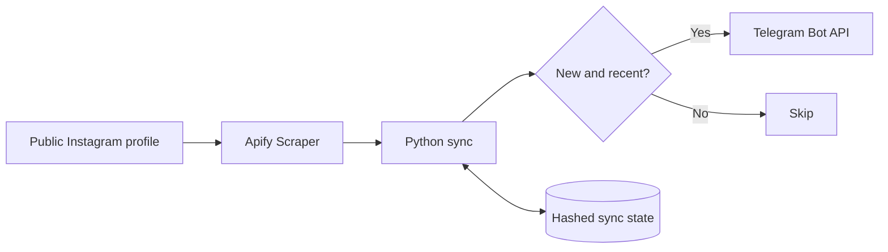

<div align="center">

# Instagram → Telegram

### Automatically repost Instagram posts, Reels and carousels to your Telegram channel.

**No server to maintain. No Instagram password. Powered by GitHub Actions + Apify.**

[](https://github.com/Bl0ck154/instagram-to-telegram/actions/workflows/instagram-to-telegram.yml)


[**Setup wizard**](https://bl0ck154.github.io/instagram-to-telegram/) · [Get started](#quick-start) · [How it works](#how-it-works) · [Costs](#costs-and-limits) · [Troubleshooting](docs/SETUP.md#troubleshooting)

</div>


<sub>Illustration of the output, not a screenshot of a real Instagram account or Telegram channel.</sub>

## What you get

| Feature | Default behavior |
| --- | --- |
| Automatic cross-posting | Checks a public Instagram profile approximately every 6 hours |
| Media | Photos, videos / Reels and mixed carousels (up to 20 items per Instagram post, split into albums of 10) |
| Captions | Preserves full text and links, using follow-up Telegram messages when needed |
| Duplicate protection | Tracks hashed identifiers and quarantines uncertain Telegram deliveries |
| No hosting | Scheduled workflow runs on GitHub Actions |
| Privacy | Bot and Apify tokens are stored in GitHub Actions Secrets |
| Safe setup | First-run baseline prevents a flood of old Instagram posts |
| Multiple accounts | Up to 20 public Instagram profiles, each mapped to a Telegram destination |
| Reporting | Run summaries: checks, published items, failures, estimated Apify results |
| Flexible | Optional advanced backends for local use, separate from lightweight default |

The default workflow uses **Apify Instagram Scraper** and the **Telegram Bot API**. Apify is an external service that may charge for usage; read [Costs and limits](#costs-and-limits).

## Quick start

Prefer a guided setup? Try the [interactive setup wizard](https://bl0ck154.github.io/instagram-to-telegram/). It generates a GitHub Actions account configuration in your browser, without collecting API tokens.

### 1. Create your own repository

Choose **Use this template → Create a new repository** at the top of this page. You can also fork the repository. Keep the workflow file in `.github/workflows/`.

> GitHub Actions scheduled workflows may be disabled in forks or new copies. Open the **Actions** tab and enable workflows if GitHub asks you to do so.

### 2. Set four values

In your copy, open **Settings → Secrets and variables → Actions**:

| Type | Name | Value |
| --- | --- | --- |
| Variable | `INSTAGRAM_USERNAME` | Public Instagram profile name, without `@` |
| Variable | `TELEGRAM_CHAT_ID` | Target channel username (e.g. `@my_channel`) or chat ID |
| Secret | `TELEGRAM_BOT_TOKEN` | Token issued by [@BotFather](https://t.me/BotFather) |
| Secret | `APIFY_TOKEN` | Token from [Apify Console](https://console.apify.com/) |

Add the bot as an **administrator of the destination channel**, with permission to post messages. If posting to a group, grant the necessary permissions there instead.

### 3. Initialize without publishing old posts

Open **Actions → Instagram to Telegram → Run workflow**. Set `initialize_only` to **true** and run once. It records the current posts without sending them to Telegram.

Check that the run succeeds. Subsequent scheduled runs will check for new posts, typically every six hours. GitHub's schedule is best-effort, so it may start later than the exact cron time.

**Want to test safely?** Trigger the workflow with `dry_run` set to **true**. It fetches and checks media but does not publish to Telegram.

For a full walkthrough, common errors and local development, see **[Setup and troubleshooting](docs/SETUP.md)**.

## How it works



The action checks posts and Reels separately; it requests the additional details fallback only when a feed is missing or media appears low resolution. It considers up to six distinct candidates per run. It downloads eligible media and sends it to Telegram. State lives in a dedicated **`sync-state`** branch so automated state commits do not clutter the development history. The branch is created automatically on the first run.

The anti-duplicate logic rejects new candidates with missing timestamps, future timestamps or publication times older than **48 hours** by default. This guards against a known Apify partial-failure case in which old Reels were returned as new content. You can change the threshold with `apify.max_post_age_hours` in `config.example.yml` (1–168 hours).

## Costs and limits

- **Apify usage is separate from GitHub Actions.** Check the [Apify Instagram Scraper pricing](https://apify.com/apify/instagram-scraper) and your account's current free credits before you run the workflow.
- The default configuration caps locally estimated Apify *results* at **1,800 per billing cycle** starting on day **26**. This is a safety guard, **not an invoice calculator or a guaranteed spending limit**. Actor runs may have different billable usage.
- Each check uses posts and Reels requests; details requests are a conditional fallback. More frequent schedules and additional accounts may use more Apify credits.
- GitHub Actions and Telegram Bot API have their own platform limits. Large files and album sizes may exceed Telegram's restrictions.
- The default setup monitors **one public Instagram account**. The optional `ACCOUNTS_JSON` variable supports up to 20 distinct public accounts, each with its own destination. Stories and private accounts are unsupported.

Do not use this tool to repost material you do not have permission to redistribute. Respect Instagram's terms, Telegram's rules and the creator's rights.

## Configuration

The four repository values above work for one account. For multiple profiles, use the `ACCOUNTS_JSON` Actions variable generated by the [wizard](https://bl0ck154.github.io/instagram-to-telegram/) instead of the two single-account variables. Optionally configure `ALERT_CHAT_ID` for failure alerts after two consecutive failed sync runs. The Actions run summary includes privacy-safe aggregate activity counters. See [`config.example.yml`](config.example.yml) for the schedule-independent settings: post scan depth, caption template, maximum age and Apify result cap.

Only **PyYAML** and **requests** are installed by the normal hosted workflow. Playwright, Telethon, Instaloader and `curl_cffi` remain optional for advanced local setups and are not used in the default production path.

### Local development

```bash
python -m venv .venv
python -m pip install -r requirements-dev.txt
python -m pytest -q
```

Once the four environment variables are set:

```bash
python -m insta_tg_sync.cli --config config.example.yml --validate
python -m insta_tg_sync.cli --config config.example.yml --dry-run
```

## FAQ

**Will the first run flood Telegram with old posts?**

No. Run `initialize_only` first; a fresh state also has a first-run baseline safeguard.

**Do I need to host anything?**

No VPS is needed for the standard scheduled workflow. You do need your own GitHub repository and Apify account.

**Do I need my Instagram password?**

No. The standard backend accesses public data through Apify.

**Can I customize captions?**

Yes. Edit `accounts[0].caption_template` in `config.example.yml`.

**Where are the secrets?**

Use GitHub Actions Secrets. Never commit tokens or sessions. See [SECURITY.md](SECURITY.md).

**Does it support multiple Instagram accounts?**

Yes. Use the [setup wizard](https://bl0ck154.github.io/instagram-to-telegram/) to create an `ACCOUNTS_JSON` variable. Each public Instagram account maps to one Telegram channel or group.

## Verified workflow example

A [real GitHub Actions dry-run](https://github.com/Bl0ck154/instagram-to-telegram/actions/runs/41366488814) shows Apify fetching, duplicate filtering and state persistence, without publishing to a real Telegram channel. The illustration above is a concept, not a screenshot.

## Related project

Need **better Instagram link previews** in Telegram, Discord or Slack instead of automated channel reposting? See [InstaFix Revived](https://github.com/Bl0ck154/InstaFix-Revived). It's an independent project for rich previews.

## Support and contributing

Found a bug? [Open an issue](../../issues/new/choose) with the sanitized workflow error, expected result and reproduction steps. Have an improvement? Read [CONTRIBUTING.md](CONTRIBUTING.md).

See [CHANGELOG.md](CHANGELOG.md) for updates. MIT licensed.
